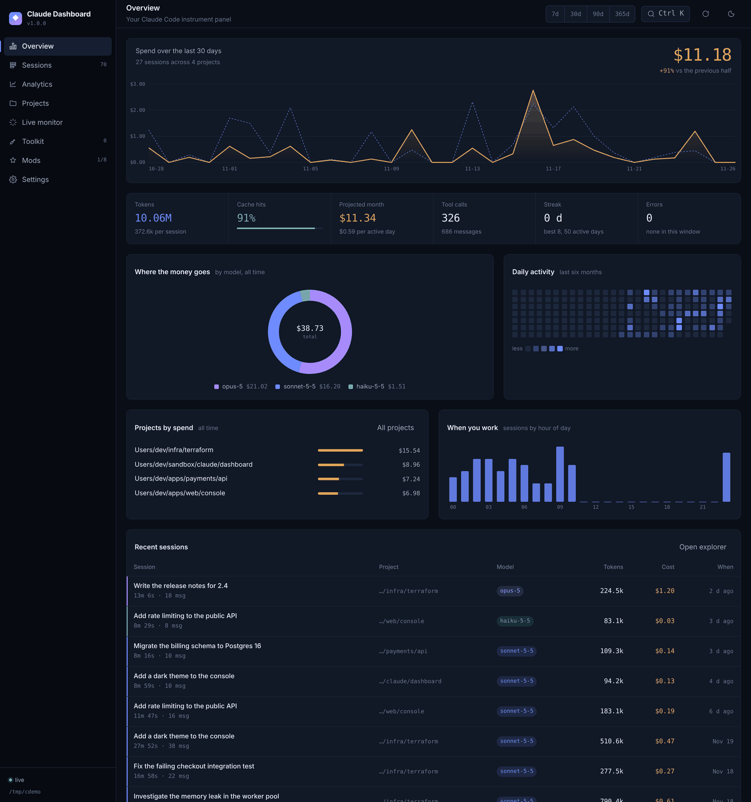
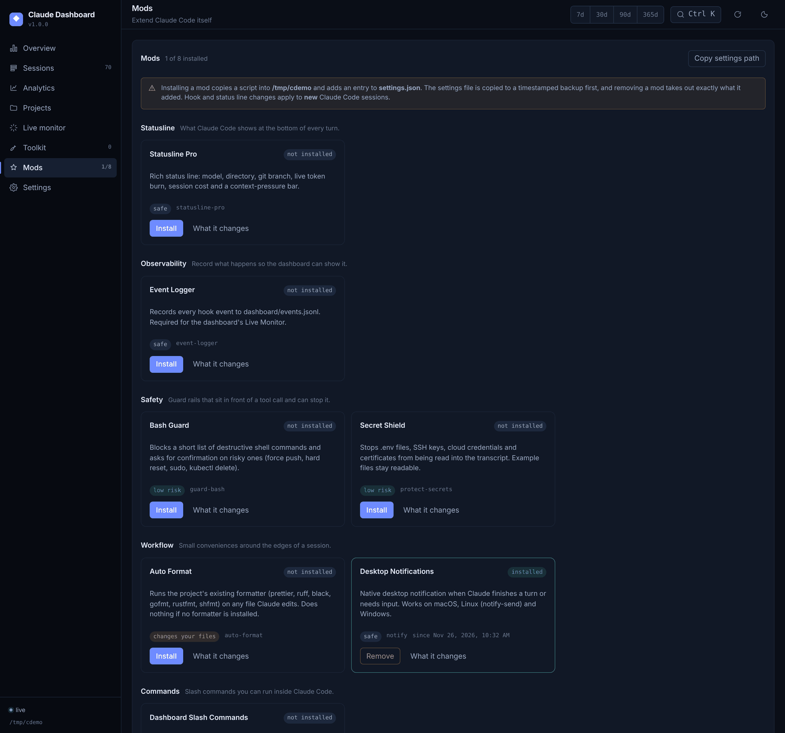
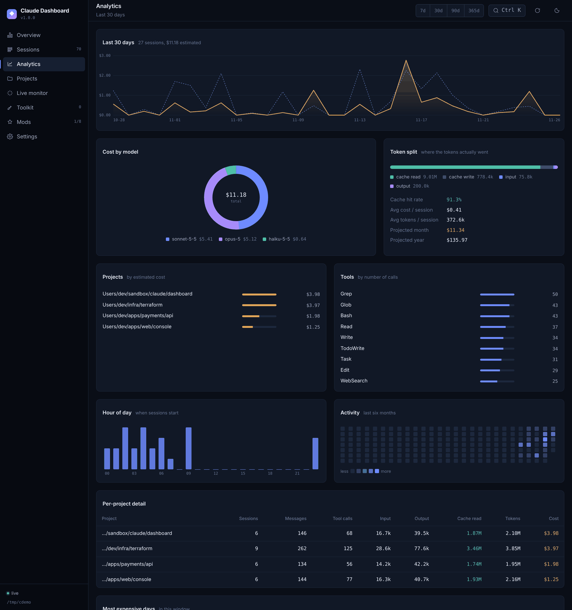
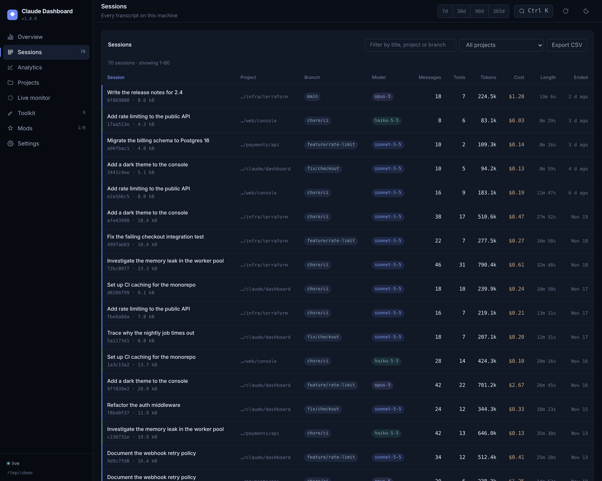
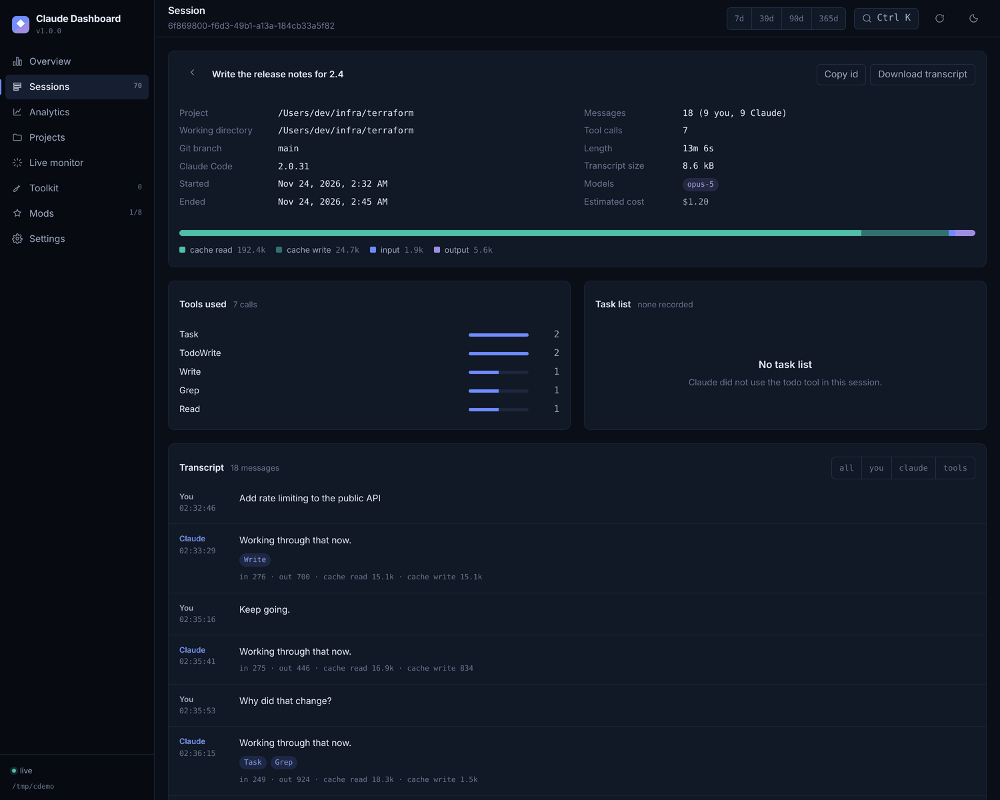
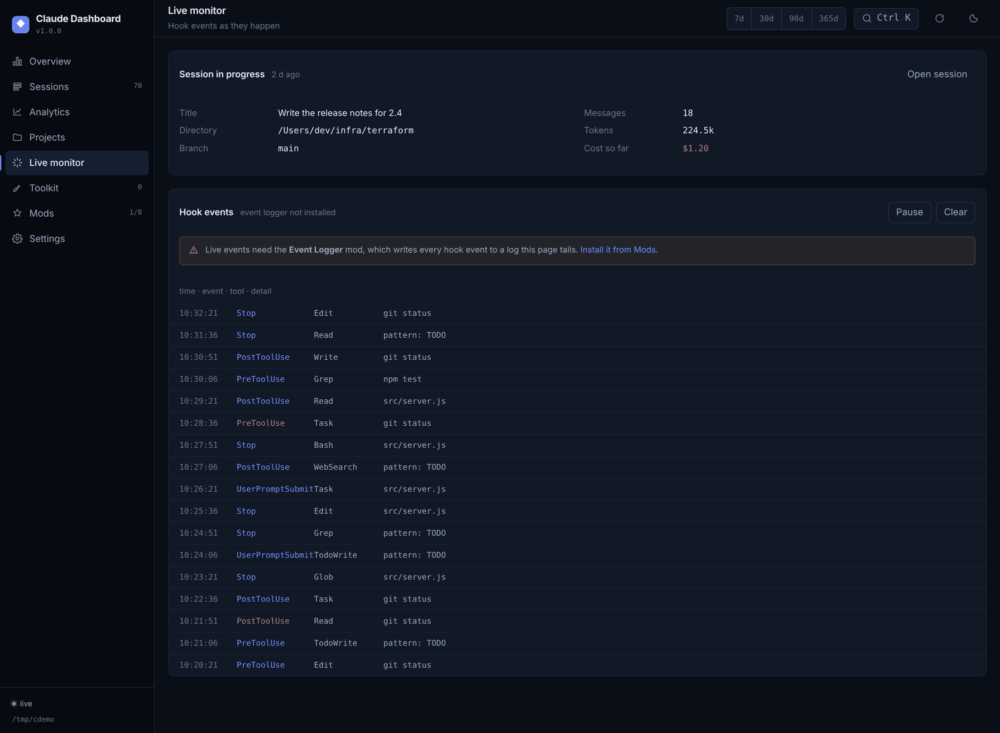

<div align="center">

# Claude Dashboard

**A local instrument panel for Claude Code — see what you ran, what it cost, and extend the CLI itself.**

[](https://nodejs.org)
[](package.json)
[](LICENSE)
[](test/dashboard.test.js)

</div>



Claude Code already writes a complete record of everything it does to `~/.claude`. Claude Dashboard
reads that record and turns it into something you can actually use: spend over time, which project
and which model the money went to, how well prompt caching is working, a searchable archive of every
session, and a live view of hook events as they fire.

It also ships **mods** — a status line, safety hooks, slash commands and a subagent that install into
Claude Code with one click and uninstall just as cleanly.

Everything runs on your machine. No account, no telemetry, no outbound requests, and **zero npm
dependencies** — the whole thing is Node's standard library plus hand-written SVG.

```bash
npx claude-dashboard
```

---

## Contents

- [What you get](#what-you-get)
- [Install](#install)
- [Quick start](#quick-start)
- [Mods](#mods)
- [Command line](#command-line)
- [Screenshots](#screenshots)
- [How it works](#how-it-works)
- [Privacy and safety](#privacy-and-safety)
- [Documentation](#documentation)
- [Contributing](#contributing)
- [License](#license)

---

## What you get

### Measurement

| | |
|---|---|
| **Spend trace** | Cost and token volume per day, with the current reading and the change against the previous period. |
| **Gauge strip** | Tokens, cache hit rate, projected monthly spend, tool calls, writing streak and errors — all in one row. |
| **Cost by model** | Where the money actually goes, split across Opus, Sonnet and Haiku. |
| **Cache analysis** | Cache reads, cache writes, fresh input and output as a share of all tokens. Low cache hit rates are the single most common cause of a surprising bill. |
| **Activity heatmap** | Six months of daily activity, plus hour-of-day distribution and streaks. |
| **Forecasts** | Projected monthly and yearly spend from your own recent trend. |

### Exploration

- **Session explorer** — every transcript on the machine, sortable by cost, tokens, messages, duration or recency, filterable by project, branch or free text.
- **Session detail** — the full conversation with tool calls, tool results, per-message token usage, the task list Claude kept, and a one-click transcript download.
- **Projects** — spend and volume grouped by working directory.
- **Toolkit** — an inventory of the skills, slash commands, subagents, MCP servers, hooks, plugins and memory files this installation is configured with.
- **Live monitor** — hook events streaming in as they happen, over server-sent events.
- **Command palette** — <kbd>⌘K</kbd> to jump to any page or search every session by title.

### Extension

Eight mods that change Claude Code itself. See [Mods](#mods).

---

## Install

**Requirements:** Node.js 18 or newer, and Claude Code installed on the same machine.

### Run it without installing

```bash
npx claude-dashboard
```

### Install globally

```bash
npm install -g claude-dashboard
claude-dashboard
```

### From source

```bash
git clone https://github.com/Kennyslab/Claude-Dashboard.git
cd Claude-Dashboard
npm link          # optional, puts `claude-dashboard` on your PATH
node bin/claude-dashboard.js
```

There is no build step and nothing to compile — `npm install` has nothing to install.

Full instructions, including running it as a background service on macOS, Linux and Windows, are in
**[docs/INSTALLATION.md](docs/INSTALLATION.md)**.

---

## Quick start

```bash
# 1. Open the dashboard (starts on http://127.0.0.1:7878 and opens a browser)
claude-dashboard

# 2. Check that everything is wired up
claude-dashboard doctor

# 3. Add the status line and the safety hooks
claude-dashboard mods install statusline-pro
claude-dashboard mods install guard-bash
claude-dashboard mods install protect-secrets

# 4. Read your numbers without leaving the terminal
claude-dashboard stats --days 7
```

Never run Claude Code before and want to see the interface anyway?

```bash
claude-dashboard demo --home /tmp/claude-demo
claude-dashboard --home /tmp/claude-demo
```

That writes synthetic transcripts to a throwaway directory. It refuses to write into a real
`~/.claude`.

---

## Mods

A mod is a small, declarative bundle: some files copied into your Claude home, plus an entry added to
`settings.json`. Install from the Mods page in the interface, or from the command line.



| Mod | What it does | Risk |
|---|---|---|
| `statusline-pro` | Status line with model, directory, git branch, live token burn, session cost and a context-pressure bar. | none |
| `event-logger` | Records every hook event to `dashboard/events.jsonl`. Powers the Live Monitor. | none |
| `guard-bash` | Blocks a short list of destructive shell commands; asks for confirmation on force pushes, hard resets, `sudo` and `kubectl delete`. | low |
| `protect-secrets` | Stops `.env` files, SSH keys, cloud credentials and certificates from being read into the transcript. Example files stay readable. | low |
| `auto-format` | Runs the project's existing formatter — prettier, ruff, black, gofmt, rustfmt, shfmt — on any file Claude edits. Does nothing if none is installed. | medium |
| `notify` | Desktop notification when Claude finishes a turn or needs input. macOS, Linux and Windows. | none |
| `commands` | Adds `/dashboard`, `/cost-report`, `/session-summary` and `/mods`. | none |
| `analyst-agent` | A `dashboard-analyst` subagent that reads the API and explains your cost drivers. | none |

**Every install is reversible.** `settings.json` is copied to a timestamped backup before any write,
the write itself is atomic, and uninstalling removes exactly the entries that were added — matched by
content, not by position. Hook and status line changes take effect in the *next* Claude Code session.

Mod internals, the install manifest format and how to write your own are in
**[docs/MODS.md](docs/MODS.md)**.

---

## Command line

```
claude-dashboard [command] [options]

COMMANDS
  serve                    Start the dashboard (default)
  mods list                List every mod and whether it is installed
  mods install <id>        Install a mod into ~/.claude
  mods remove <id>         Remove a mod and undo its settings changes
  stats                    Print a usage summary in the terminal
  export                   Write a usage export to stdout
  doctor                   Diagnose the installation
  demo                     Generate synthetic data for a test drive

OPTIONS
  -p, --port <n>           Port to listen on                   (default 7878)
  -H, --host <addr>        Address to bind                     (default 127.0.0.1)
      --home <dir>         Use a different Claude home         (default ~/.claude)
      --token [secret]     Require a token; omit the value to generate one
      --read-only          Refuse every mutating API request
      --no-open            Do not open a browser
      --days <n>           Window for stats and export         (default 30)
      --format <fmt>       json | csv                          (export only)
```

```bash
claude-dashboard stats --days 7                  # last week, in the terminal
claude-dashboard export --format csv > use.csv   # spreadsheet export
claude-dashboard --read-only --port 9000         # safe to share on a pairing session
```

---

## Screenshots

<table>
<tr>
<td width="50%"><br><sub><b>Analytics</b> — cost by model, token split, per-project detail and cache efficiency.</sub></td>
<td width="50%"><br><sub><b>Session explorer</b> — every transcript, sortable and filterable. The coloured left edge is the dominant model.</sub></td>
</tr>
<tr>
<td width="50%"><br><sub><b>Session detail</b> — the full conversation, tool calls, per-message usage and the task list.</sub></td>
<td width="50%"><br><sub><b>Live monitor</b> — hook events streaming in as they fire.</sub></td>
</tr>
</table>

---

## How it works

```
~/.claude/
├── projects/<encoded-cwd>/<session>.jsonl   transcripts, one JSON object per line
├── settings.json                            hooks, status line, model
├── skills/ commands/ agents/ plugins/       what the CLI can do
└── dashboard/                               created by this tool
    ├── events.jsonl                         written by the event-logger mod
    ├── pricing.json                         your price overrides
    └── mods.json                            which mods are installed
```

1. **Index.** Every `.jsonl` transcript is streamed line by line and reduced to a session summary.
   Indexing is incremental: a file is only re-read when its size or modification time changes.
2. **Aggregate.** Summaries are rolled up into timelines, heatmaps and per-project and per-model
   breakdowns. The frontend never does arithmetic over raw transcripts.
3. **Serve.** A `node:http` server exposes a read-only JSON API plus a server-sent-events stream, and
   serves the interface as static files. No framework, no bundler.
4. **Watch.** A cheap directory fingerprint is polled every 2.5 seconds; when it changes, connected
   browsers are told to refresh. `fs.watch` is not reliable enough across platforms for deep trees.

The architecture, the transcript schema and the reasoning behind the design are written up in
**[docs/ARCHITECTURE.md](docs/ARCHITECTURE.md)**.

### About the cost figures

Costs are **estimates**, not billed amounts. Token counts come from the `usage` object the API
returns, which Claude Code records in the transcript; those counts are multiplied by a price table.
Cache reads and cache writes are billed at their own rates, which is why a naive input-plus-output
calculation badly under-reports a heavily cached session. You can edit the price table in Settings or
in `~/.claude/dashboard/pricing.json`, and every figure recalculates.

---

## Privacy and safety

- **Nothing leaves your machine.** The server makes no outbound network requests. Your transcripts
  are read from disk and sent to your own browser over loopback.
- **Loopback by default.** The server binds `127.0.0.1`. Binding any other address without `--token`
  is refused outright.
- **Mutating requests are gated.** Installing a mod or saving a price table requires a POST or PUT
  carrying a custom header, so a web page you happen to have open cannot drive your local server.
  `--read-only` disables them entirely.
- **Path containment.** The static handler resolves every request inside `public/` and refuses
  anything outside it.
- **Backups before writes.** The only file this tool ever modifies is `settings.json`, and it is
  copied aside first.

---

## Documentation

| | |
|---|---|
| **[Installation](docs/INSTALLATION.md)** | Every install route, running as a service, upgrading, uninstalling. |
| **[User guide](docs/DOCUMENTATION.md)** | Every page and every number explained, plus keyboard shortcuts. |
| **[Mods](docs/MODS.md)** | What each mod changes, the manifest format, writing your own. |
| **[API reference](docs/API.md)** | Every endpoint, parameter and response shape. |
| **[Configuration](docs/CONFIGURATION.md)** | Flags, environment variables, price overrides. |
| **[Architecture](docs/ARCHITECTURE.md)** | How indexing, aggregation and the live stream work. |
| **[Troubleshooting](docs/TROUBLESHOOTING.md)** | When the numbers look wrong or nothing shows up. |

---

## Contributing

Issues and pull requests are welcome. `npm test` runs the suite against synthetic data in a temporary
directory, so it never touches your real history. See **[CONTRIBUTING.md](CONTRIBUTING.md)**.

## License

MIT — see [LICENSE](LICENSE).

> Claude Dashboard is an independent project. It is not affiliated with or endorsed by Anthropic.
