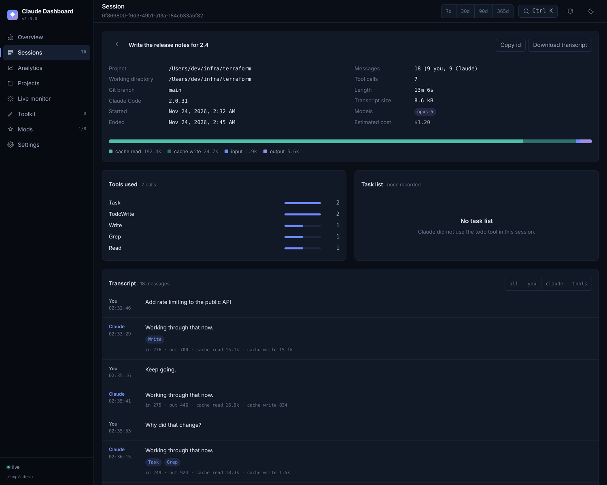
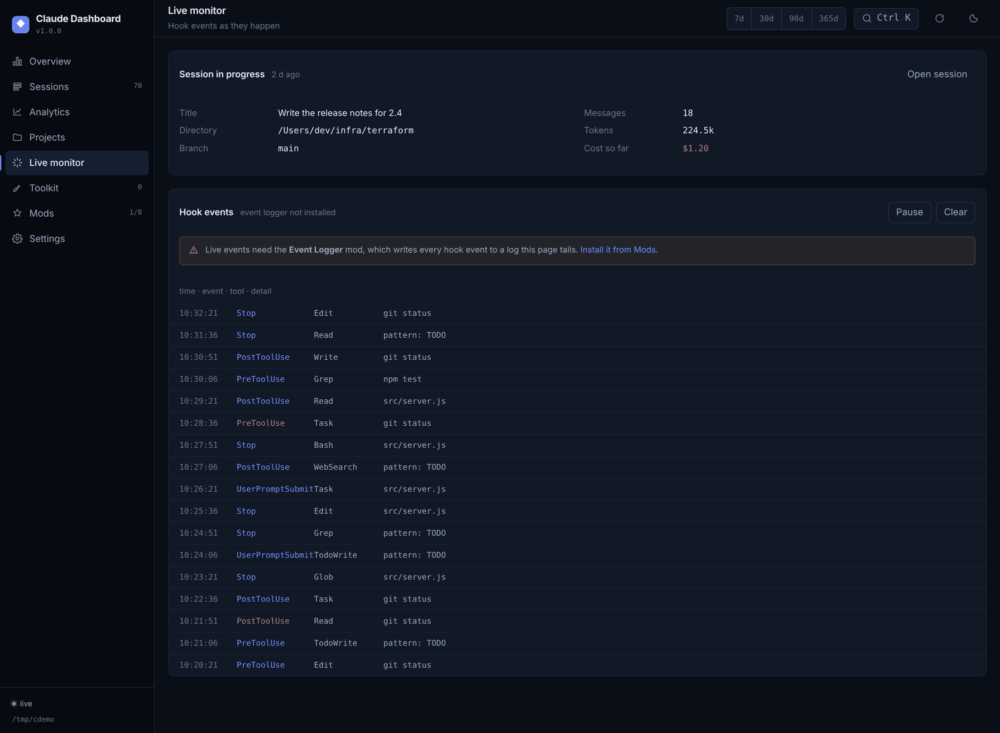

# User guide

Every page, and what each number means.

- [Reading the interface](#reading-the-interface)
- [Overview](#overview)
- [Sessions](#sessions)
- [Session detail](#session-detail)
- [Analytics](#analytics)
- [Projects](#projects)
- [Live monitor](#live-monitor)
- [Toolkit](#toolkit)
- [Mods](#mods)
- [Settings](#settings)
- [Keyboard shortcuts](#keyboard-shortcuts)
- [Exporting](#exporting)
- [How the numbers are produced](#how-the-numbers-are-produced)

---

## Reading the interface

Colour carries meaning and is consistent on every page:

| Colour | Means |
|---|---|
| **Blue** | Token volume — how much text moved. |
| **Sand** | Money. |
| **Teal** | Cache efficiency. |
| **Violet** | Opus, and output tokens in the token split. |
| **Coral** | Errors and blocked actions. |

Numbers are set in a monospaced face throughout so that digits line up column to column. The time
range in the top bar (7, 30, 90 or 365 days) applies to the Overview and Analytics pages and is
remembered between visits. Sessions, Projects and Toolkit always show everything.

---

## Overview

The landing page answers one question: what is this costing, and is that changing?

**The trace** is the hero of the page — spend per day as a filled line, with token volume behind it
as a dotted line so you can see when they diverge. A rising cost line against a flat token line means
the model mix got more expensive; the reverse means caching improved. Hover anywhere for that day's
exact figures. The reading on the right is the window total; underneath it, the change against the
previous half of the same window.

**The gauge strip** holds six readings:

| Reading | What it tells you |
|---|---|
| Tokens | Total tokens in the window, and the average per session. |
| Cache hits | Cache reads as a share of all input-side tokens. Above 80% on a mature project is healthy; below 40% usually means context is being rebuilt from scratch each turn. |
| Projected month | Your recent daily rate extrapolated to a full month. |
| Tool calls | How much work was done with tools rather than conversation. |
| Streak | Consecutive days with at least one session, your best run, and total active days. |
| Errors | API error messages recorded in the transcripts. |

**Where the money goes** splits all-time spend by model. **Daily activity** is six months of sessions
per day. **Projects by spend** and **When you work** rank your directories and show the hour-of-day
distribution of session starts.

---

## Sessions

Every transcript on the machine, newest first.

Click any column header to sort: by cost to find the expensive ones, by tokens to find the ones that
dragged a lot of context, by duration to find the ones that ran long. The filter box matches session
title, project path and git branch. The project dropdown narrows to one working directory.

The coloured bar on the left edge of each row is the session's dominant model — violet for Opus,
blue for Sonnet, teal for Haiku. It is there so you can see your model mix by scanning the edge of
the table rather than reading the Model column.

A session's **title** is its first real user message, or the summary Claude Code recorded for it.

---

## Session detail



The top panel is the session's metadata and readings, with a stacked bar showing where its tokens
went: cache reads, cache writes, fresh input and output. On a well-cached session the teal segment
dominates, and that is what keeps the cost down.

Below that, the tools the session used, ranked, and the task list Claude kept if it used one.

The transcript shows every message with its timestamp, any tool calls it made, a preview of the tool
result, and the token usage the API reported for that turn. The filter above it narrows to just your
messages, just Claude's, or just the turns that touched a tool. **Download transcript** gives you the
raw JSONL.

---

## Analytics

The same measurements as the Overview, cut more ways and filtered to the selected window.

- **Cost by model** — the share each model took.
- **Token split** — the four token classes, plus cache hit rate, averages per session and projected
  monthly and yearly spend.
- **Projects** and **Tools** — ranked bars.
- **Hour of day** and **Activity** — when the work happened.
- **Per-project detail** — the full table, including input, output and cache-read tokens per project.
  Click a row to jump to that project's sessions.
- **Most expensive days** — the three days that cost the most, which is usually where to start when a
  bill surprises you.

---

## Projects

Claude Code stores transcripts under an encoded form of the working directory, so "project" here
means the directory you ran it in. The table shows volume, cost and the last time you worked there.
Click a row to see that project's sessions.

---

## Live monitor



**Session in progress** follows the most recently updated transcript: its title, directory, branch,
message count and running cost.

**Hook events** is a live feed. Each row is one hook firing: the time, the event name, the tool
involved and a short detail — the command for a Bash call, the path for a file edit. Blocked actions
are shown in coral with the reason. Pause freezes the feed without disconnecting.

This feed needs the **Event Logger** mod, which is what writes the log the page tails. Without it the
panel says so and links to the Mods page.

---

## Toolkit

An inventory of what this Claude Code installation can actually do, in eight tabs: Skills, Slash
commands, Subagents, MCP servers, Hooks, Plugins, Memory files and Task lists.

This is the page to open when you are wondering why Claude did something unexpected — a skill or a
hook you forgot about is usually the answer. The Hooks tab in particular shows every command that
runs around your tool calls, including ones installed by something other than this dashboard.

---

## Mods

See **[MODS.md](MODS.md)** for what each mod does and how the install mechanism works.

The short version: **Install** copies a script into `~/.claude/dashboard/mods/` and adds an entry to
`settings.json`, after copying that file to a timestamped backup. **Remove** takes out exactly what
was added. **What it changes** prints the manifest so you can read it before deciding.

Hook and status line changes apply to the *next* Claude Code session, not the one you have open.

---

## Settings

- **This installation** — paths, versions, mode.
- **Price table** — the USD-per-million-token rates used for every cost figure in the dashboard. Edit
  any cell and press Save; everything recalculates immediately. Reset restores the built-in defaults.
- **Configuration files** — where your settings live and whether each file exists. Click a row to copy
  the path.
- **Effective settings** — `settings.json` merged with `settings.local.json`, which is what Claude
  Code actually acts on.
- **Your data** — full JSON and CSV exports, and a button to force a complete reindex.

---

## Keyboard shortcuts

| Key | Action |
|---|---|
| <kbd>⌘K</kbd> / <kbd>Ctrl</kbd>+<kbd>K</kbd> | Command palette |
| <kbd>/</kbd> | Command palette |
| <kbd>1</kbd>–<kbd>8</kbd> | Jump to a page in rail order |
| <kbd>t</kbd> | Switch between dark and light |
| <kbd>r</kbd> | Reindex transcripts |
| <kbd>↑</kbd> <kbd>↓</kbd> <kbd>⏎</kbd> | Navigate and open in the palette |
| <kbd>Esc</kbd> | Close the palette |

The command palette searches pages, actions and every session by title and project, so it doubles as
the fastest way to reopen a session you remember by name.

---

## Exporting

From the interface, Settings → Your data, or Sessions → Export CSV.

From the command line:

```bash
claude-dashboard export --format csv --days 90 > q3.csv
claude-dashboard export --days 3650 > everything.json
```

From the API:

```
GET /api/export?format=csv&days=90
```

The CSV has one row per session with id, timestamps, project, branch, message and tool counts, the
four token classes, total tokens, estimated cost, models used and the title. It opens cleanly in
Excel, Numbers and Sheets.

---

## How the numbers are produced

Claude Code appends one JSON object per line to
`~/.claude/projects/<encoded-working-directory>/<session-id>.jsonl`. Assistant turns carry a `usage`
object from the API with four counts: `input_tokens`, `output_tokens`,
`cache_creation_input_tokens` and `cache_read_input_tokens`.

The dashboard streams each file, sums those four counts per session — de-duplicating by request id,
because a single request can appear on several lines — and multiplies each class by its own rate from
the price table.

**This matters:** cache reads cost roughly a tenth of fresh input tokens, and cache writes cost about
a quarter more. Adding input and output alone can over-report a cached session several times over.

### What the figures are not

They are **estimates**, computed locally. They do not know about your plan, your included usage,
subscription pricing, rate-limit behaviour, or any discount. Treat them as a precise measure of
*relative* cost — which project, which model, which day — and an approximate measure of absolute
spend. For what you were actually billed, check your Anthropic Console.
